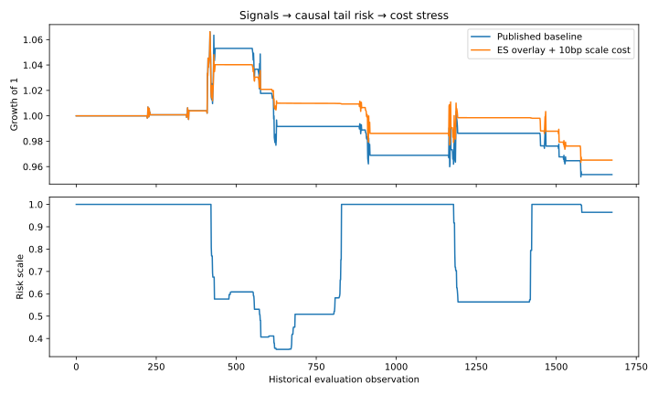

# Integrated Real Assets Research

## Three components, one research workflow
1. **Signals:** inherited walk-forward cointegration/Kalman listed-property research and its full calculation trail.
2. **Risk:** lagged expected-shortfall scaling applied to the published net-return stream.
3. **Execution:** FIFO matching/replay and paired immediate-versus-TWAP experiments, with fill and shortfall diagnostics.

This repository integrates the previous signal, risk and execution work. It is not three independent alpha discoveries. Source ancestry: [listed-property research](https://github.com/Anjaney336/india-realestate-quant-backtest), [execution lab](https://github.com/Anjaney336/quant-execution-lab), accessed 24 October 2026. Their original repositories remain intact.

## Mathematics
At observation t, ES_t is the mean of the worst ceil(5%×252) losses from returns t−252 through t−1. Risk scale q_t=min(1,0.005/max(ES_t,ε)). The first 252 observations use scale 1 because history is insufficient.

Counterfactual overlay return: (1+q_t r_t)(1−c|q_t−q_{t−1}|)−1. Baseline r_t already includes its original costs; c is an additional scale-adjustment cost. This is return-stream scaling, not a full order-level rerun. No fabricated execution calibration is substituted for historical fills.

Implementation shortfall includes executed-price slippage, fees and terminal-mid opportunity cost of unfilled quantity. Synthetic immediate/TWAP policy runs are paired by seed. See `execution/ENGINE_DESIGN.md` for matching invariants and SQLite replay.

## Results
Across 1,675 inherited historical evaluation observations, baseline total return is −4.63% with −10.71% maximum drawdown. At 10bp incremental scale cost, the overlay returns −3.49% with −9.64% maximum drawdown; 748 days are scaled down. This is risk reduction in a losing strategy, not evidence of profitable alpha. Execution bridge evaluates 200 synthetic policy runs; the separate robustness grid contains 1,800 runs.



## Structure and verification
`integrated.py`, `test_integrated.py`: six integration tests, including future-mutation causality and exact tail scaling. `signals/`: original strategy source, 27 tests and research results. `execution/`: original simulator, 20 tests and results. 53 tests in the combined reproduction command. Full signal regeneration requires the signal dependencies and, for historical replay, source data described in `signals/README.md`.

## Limitations
The same historical sample has already been inspected; this is retrospective analysis. Scaling does not recreate individual order sizes or market impact. Source strategy uses hypothetical borrow and vendor-adjusted prices. The execution model replenishes depth independently and has no calibrated queue, feedback or impact. Do not infer that the return overlay is deployable.

## Evidence and interpretation

All generated inputs are assumptions, not empirical observations. Historical experiments are retrospective research, not a live track record. No employer sponsorship or investment recommendation is implied. Code was developed with AI assistance; the candidate must be able to reproduce, explain and modify it in interviews.

Source names, URLs and access dates are recorded in results JSON and the inherited methodology. Raw vendor price data are not redistributed. Use a lawfully obtained local CSV to reproduce historical runs; the default run is fully offline and synthetic.

## Reproduce and test

Python 3.12:
```bash
python -m pip install -r requirements.txt
python reproduce.py
```
GitHub Actions runs the same research entry point. Historical caches are deliberately excluded from CI. Generated CSVs are the audit trail; SVG figures are derived from those CSVs or the same in-memory results.
