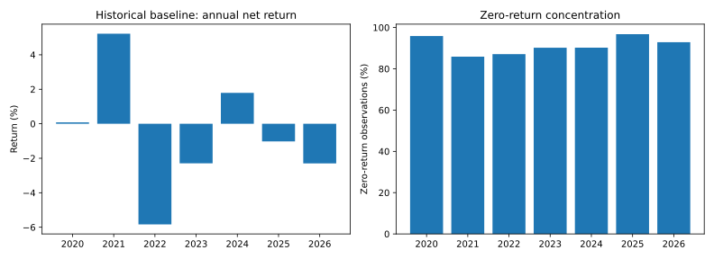

# Indian Real Estate Quantitative Relative Value

**A crossover project for listed-property investment research and quantitative portfolio analysis.**

Cointegration, Kalman hedge ratios, walk-forward testing and causal downside-risk monitoring.

Anjaney Malhotra · Mechanical Engineering, VIT Vellore · Investment and data analytics portfolio

[Read the research case](https://anjaney336.github.io/portfolio/quant-research/) · [Companion property underwriting](https://github.com/Anjaney336/bengaluru-office-underwriting)

## Result first

The predeclared baseline did **not** establish a robust edge. On vendor-adjusted historical prices from **14 January 2020 to 19 October 2026**, the entry-z=2 baseline returned approximately **-0.71% CAGR**, **-0.13 Sharpe**, and **10.71% maximum drawdown**, after the stated execution and borrowing assumptions. The result covers **1,675 out-of-sample observations**, including days held in cash. The 20-day block-bootstrap Sharpe interval crosses zero.


This is conditional historical research, **not a tradable, borrow-verified strategy**. The run explicitly permits hypothetical shorts. Actual security eligibility, locate availability, fees, collateral and recalls have not been verified. Without an explicit short-permission input or the research override, the execution engine rejects pairs requiring unavailable shorts.

The baseline is not replaced with the best-performing threshold after seeing the test results. The full threshold registry and cost sensitivities are published. A negative baseline is a research finding, not a reason to hide or relabel the experiment.

## What is implemented and what was run

| Component | Implementation | Published evidence |
|---|---|---|
| Price / liquidity loader | yfinance cache, hashes, symbol and coverage audit | Historical REIT and developer prices; raw cache stays local |
| Engle-Granger | Training-only pair tests; Holm correction | Historical and synthetic runs |
| Johansen | Training-window trace test diagnostic | Selection audit; not a second optimization gate |
| OU half-life | AR(1) phi mapped to exact discrete half-life | Training screen and time stop |
| Kalman filter | Causal intercept / hedge-ratio update | Historical and synthetic signals |
| Rate HMM | Two or three Gaussian states; forward-only inference | Synthetic integrated run and unit tests |
| Distribution-yield spread | Point-in-time distributions minus G-sec yield; lagged rolling z-score | Synthetic integrated run and helper tests |
| Execution | Next-close trade, drifted dollar holdings, costs, borrowing and lagged ADV | Historical ledger and tests |
| Risk / statistics | CAGR, Sharpe, Sortino, Calmar, drawdown, block bootstrap, DSR | JSON, CSV and chart outputs |

**No authenticated RBI/CCIL yield history or complete historical REIT-distribution event set was obtained for this build. Those overlays are disabled in the published historical run.** The synthetic HMM/yield-spread run is prominently labeled and is not evidence of Indian market returns. The input contracts are implemented so verified data can be supplied later without changing the model.

## Reproduce

Python 3.12 is the tested version. Dependencies are pinned in `requirements.txt`; the creation environment is recorded in `requirements-lock.txt`.

```bash
python -m venv .venv
# Activate .venv using your operating system's standard command.
python -m pip install -r requirements.txt
python -m pytest -q
python run.py --mode demo --hypothetical-shorts
python run.py --mode historical --start 2019-01-01 --end 2026-10-22 --hypothetical-shorts
```

For an authenticated local rate export:

```bash
python run.py --mode historical --rates-csv data/raw/gsec.csv --distribution-yields-csv data/raw/known_yields.csv --hypothetical-shorts --output results/local-overlay
```

The last command requires the documented real inputs; it does not generate a rate history. Omit `--hypothetical-shorts` to retain the default no-unverified-borrow gate. No broker API, account credentials or order submission is implemented.

Use `OPENBLAS_NUM_THREADS=1` and `OMP_NUM_THREADS=1` when deterministic resource use matters. GitHub Actions runs tests and the synthetic pipeline without relying on a live market-data provider.

## Research design

1. Use rolling **252-observation training / 63-observation test** windows. Instruments enter selection only when their full training window is observed. The Nifty Realty index is never traded; its downloaded history was insufficient, so no index comparison is claimed.
2. Regress log-price y on a constant and log-price x; run Engle-Granger with one lag and a constant. Apply Holm's 5% family-wise correction to all tested pairs in that window. Report ADF and Johansen diagnostics. I(1) preconditions remain a modeling assumption; finite-sample tests do not establish economic equilibrium.
3. Keep only positive hedge ratios between 0.2 and 5 and half-lives between 2 and 60 observations. Select the surviving pair with the smallest training p-value. If none survives, hold cash. Fixed current-universe selection still introduces survivorship / universe bias.
4. Fit residual AR(1) with intercept. For 0 < phi < 1, half-life = -log(2)/log(phi). Reject non-mean-reverting or oscillating estimates. The static training residual estimates a reference timescale; it is not proof that the later adaptive residual is an exact OU process.
5. Initialize the Kalman intercept/slope from the training regression. Update once per observed test close. Normalize the prior innovation by training residual volatility. Enter at |z| >= 2, exit below 0.25, stop above 4, and time-stop after twice the fitted half-life. Fold changes reset signal state; delayed execution and turnover still pass through the ledger.
6. Use target gross exposure <=80% and leg size <=50% of NAV. These are log-return hedge approximations, not exact risk neutrality. Position limits apply to targets; realized exposures can drift, especially under liquidity constraints.
7. When verified rates are supplied, fit a Gaussian HMM on training rate changes standardized using training statistics. Freeze HMM parameters in the test fold and use only forward probabilities. Full-sequence Viterbi / smoothed posteriors are not used for trading. Lower/higher mean rate-change states are descriptive falling/rising-yield states, not causal monetary-policy labels.
8. A signal observed at close t can trade at **close t+1**. Its first close-to-close price P&L occurs at t+2. Costs are charged at the trade; short borrow accrues on calendar days. Dollar holdings drift before turnover is calculated. Common fill scaling caps each leg's traded value to 1% of the previous 20-day average traded value.

## Frictions and conventions

Defaults are **research assumptions**, not verified current broker quotes or a legal/tax schedule: 3bp brokerage + 10bp slippage + 2bp other fees per traded notional, 10bp STT allowance on buys and sells, and 6% annual short-borrow charge. Historical instrument- and date-specific charges must replace these inputs before making any execution claim. The single STT allowance is deliberately disclosed rather than represented as exact REIT taxation.

Cash earns zero. Sharpe and Sortino use a zero return hurdle, not a 10-year bond yield as a cash risk-free rate. Annualization assumes 252 observations. NAV is marked to market; terminal holdings are reported and are not artificially liquidated outside liquidity constraints. The published baseline ends flat. Fractional exposure, constant borrow availability under the override, no margin calls, no recalls, no intraday spreads, no auction impact and simplified total-return short accounting are limitations.

## Statistical evidence

- **Bootstrap:** 1,000 seeded circular moving-block resamples, block length 20, reporting 2.5%, median and 97.5% quantiles. This does not repeat the entire model-selection process; it measures conditional return-sequence uncertainty.
- **Deflated Sharpe:** Bailey and Lopez de Prado's expected maximum Sharpe benchmark, daily SR units and Pearson kurtosis. The registry counts three entry thresholds (1.5 / 2 / 2.5) plus two additional cost stress variants (5 / 25bp), five variants total. The 10bp baseline is not double-counted. Correlated variants and serial dependence weaken the approximation; the score is not proof of alpha. Undefined Sharpe for a no-trade variant is not silently converted to zero: DSR is withheld in that case.
- **No holdout tuning claim:** parameter sensitivity is disclosed. The research has not been independently replicated or prospectively paper-traded.

## Files for reviewers

- `src/data_loader.py` — validation, cache, publication-aware rates and distribution events.
- `src/signals.py` — cointegration, Holm, OU, Kalman and yield spreads.
- `src/regime_hmm.py` — training and forward-only inference.
- `src/backtest.py` — walk-forward selection and execution ledger.
- `src/metrics.py` — return statistics, DSR and bootstrap.
- `tests/test_research.py` — 21 tests, including future-data mutation, execution lag, prior-volume limits, known cash-flow identities and missing-data behavior.
- `notebooks/` — four walkthroughs for data, pair selection, regimes and results.
- `results/historical/` — audited historical outputs, including all selection diagnostics and parameter trials.
- `results/demo/` — separate synthetic validation outputs.
- `data/README.md` — source links, schemas and limitations.

## Primary references

- [Statsmodels Engle-Granger documentation](https://www.statsmodels.org/stable/generated/statsmodels.tsa.stattools.coint.html)
- [Statsmodels Johansen documentation](https://www.statsmodels.org/stable/generated/statsmodels.tsa.vector_ar.vecm.coint_johansen.html)
- [hmmlearn documentation](https://hmmlearn.readthedocs.io/en/stable/)
- [Bailey and Lopez de Prado, The Deflated Sharpe Ratio (2014)](https://www.davidhbailey.com/dhbpapers/deflated-sharpe.pdf)
- [NSE Securities Lending and Borrowing Scheme](https://www.nseindia.com/static/products-services/slbs-features)
- [yfinance documentation and data-use notice](https://ranaroussi.github.io/yfinance/)

Developed for Anjaney Malhotra's portfolio with AI coding assistance. No employer sponsorship, live trading returns or proprietary employer data are claimed. Review the mathematics and reproduce the findings before presenting the project in interviews.

## Portfolio-risk extension (24 October 2026)

Run `python src/tail_diagnostics.py` against the published historical ledger. The **27-test** suite now includes six tail-diagnostic tests for quantile interpolation, exclusion of current/future observations, all-cash ties, scale equivariance, invalid returns and tail ordering.

The rolling diagnostic uses the previous 252 observations to estimate 95% loss VaR and a threshold-tail average. It evaluates **1,423 forecasts with 71 exceedances (4.99%)**. The ledger contains **1,528 zero-return days out of 1,675**, including a 257-day zero-return spell. This concentration matters: a near-5% breach rate alone does not establish calibration, independence or usefulness. The tail average includes ties and is not presented as exact fixed-probability-mass Expected Shortfall.

For real estate teams this demonstrates disciplined listed-property risk monitoring, exposure/cost interpretation and a willingness to reject a weak investment thesis. It is not direct property valuation. For quant teams it demonstrates causal estimation, multiple-testing controls, execution accounting and explicit negative findings. Public filings and a tenant-level property model belong in the [companion underwriting repository](https://github.com/Anjaney336/bengaluru-office-underwriting).

Derived data source: [published ledger](https://github.com/Anjaney336/india-realestate-quant-backtest/blob/main/results/historical/ledger.csv), underlying [Yahoo Finance](https://finance.yahoo.com/), accessed 24 October 2026 for this extension. Historical source acquisition dates remain in data manifests. No new market data were fetched. Full equations, forecast rows and input hash are in `src/tail_diagnostics.py` and `results/risk/`.

The matching simulator formerly embedded under execution_lab has moved to the standalone [Quant Execution Lab](https://github.com/Anjaney336/quant-execution-lab). It is a separate project and is not counted as evidence for the historical strategy.

## Annual historical diagnostics

Year-by-year net returns and zero-return concentration from the existing published ledger; no new threshold tuning or regenerated prices.



Run `python annual_diagnostics.py` after installing `matplotlib==3.10.7`. Sources are the existing documented fixture/ledger, accessed 24 October 2026. All sensitivity inputs are assumptions.
